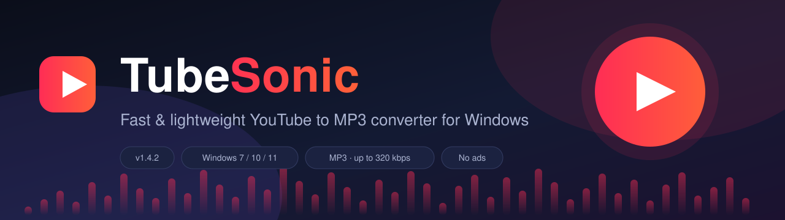
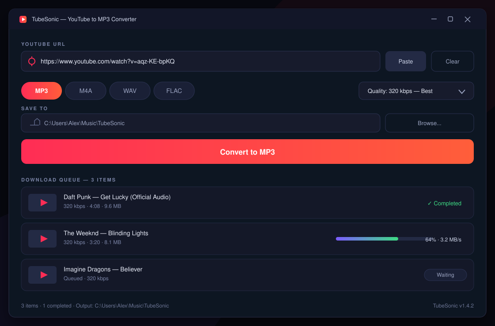

# 🎵 TubeSonic

**A fast, lightweight YouTube to MP3 converter for Windows**

Batch queue · Up to 320 kbps · Smart ID3 tags · Clean dark UI · No ads

Download `TubeSonic-Setup-1.4.2-win64.zip`, unzip it and run the installer.

---

## ✨ Features

- 🎧 **High-quality audio** — MP3 up to 320 kbps, plus M4A, WAV and FLAC output
- 📃 **Batch & playlist queue** — paste multiple links and convert them in one go
- 🏷️ **Smart tags** — automatic ID3 metadata: title, artist, album and embedded cover art
- ⚡ **Fast engine** — parallel conversions with automatic retries
- 🗂️ **Filename templates** — `{artist} - {title}`, track numbering, playlist subfolders
- 🌙 **Modern dark UI** — clean and distraction-free, no ads, no bundled extras
- 🖥️ **Lightweight** — small footprint, runs on Windows 7 and newer

## 🖼️ Screenshot

  

## 🚀 Installation

1. Go to **[Releases](releases/latest)** and download `TubeSonic-Setup-1.4.2-win64.zip`
2. Unzip it to any folder
3. Run `TubeSonic-Setup-1.4.2.exe` and follow the setup wizard
4. Launch TubeSonic from the Start menu or the desktop shortcut

> **Requirements:** Windows 7 / 10 / 11 (64-bit) · ~200 MB of free disk space

## 📖 How to use

1. Copy a YouTube link to the clipboard
2. Click **Paste** in TubeSonic
3. Pick the format (MP3 / M4A / WAV / FLAC) and quality
4. Hit **Convert to MP3** — finished files land in `Music\TubeSonic` by default

## ⚙️ Configuration

All settings live in `config\settings.json` next to the app:

| Section | What it controls |
|---|---|
| `output` | Save folder, filename template, playlist subfolders |
| `audio` | Format, bitrate, volume normalization, tag embedding |
| `downloads` | Parallel tasks, retries, timeouts |
| `ui` | Language, theme, tray behavior, clipboard watching |

## ❓ FAQ

**Is TubeSonic free?**
Yes — it is free for personal use and distributed under the MIT license.

**Where are converted files saved?**
By default in `%USERPROFILE%\Music\TubeSonic`. You can change it in the app or in `settings.json`.

**Does it support playlists?**
Yes — paste a playlist link and every item is added to the queue automatically.

## 📋 Changelog

See [CHANGELOG.md](CHANGELOG.md).

## ⚖️ Legal

TubeSonic is intended for personal use. Please convert only content you own or have permission to use, and respect YouTube's Terms of Service and the copyright law of your country.

## 🪪 License

[MIT](LICENSE) © 2026 TubeSonic Contributors
